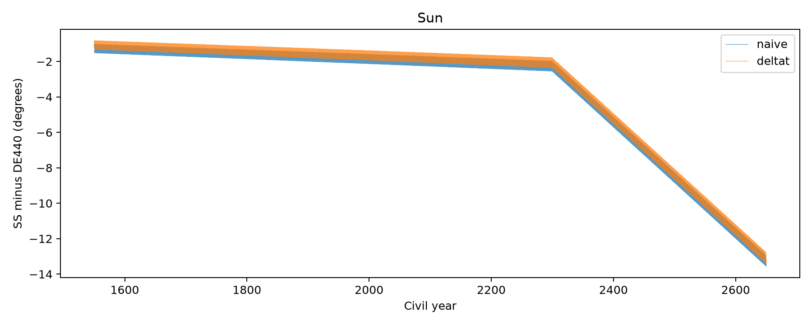
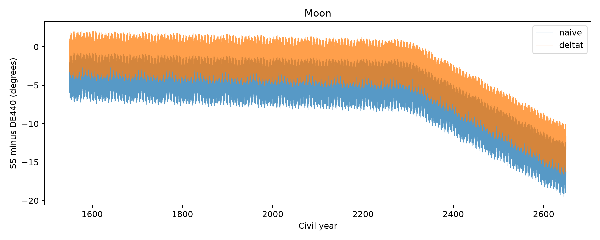
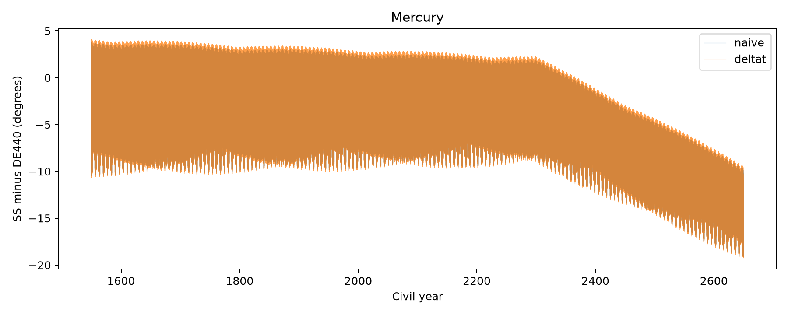
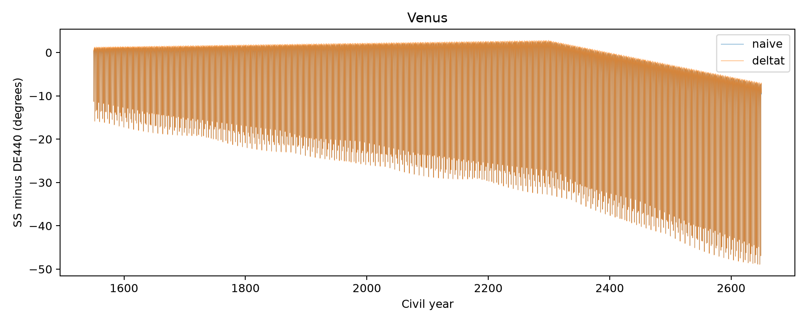
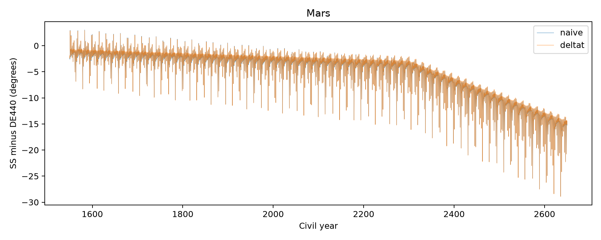
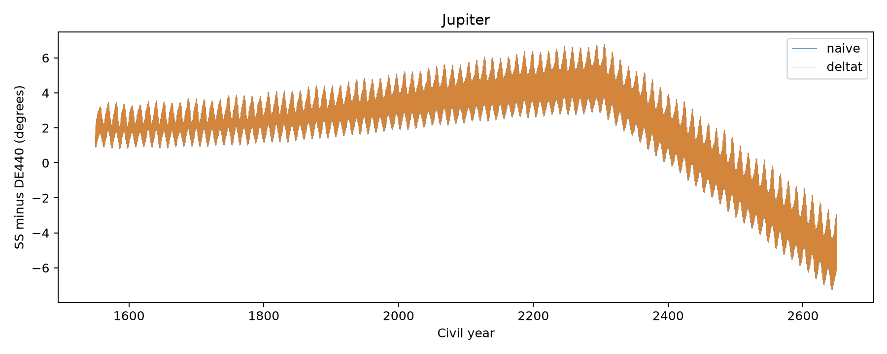
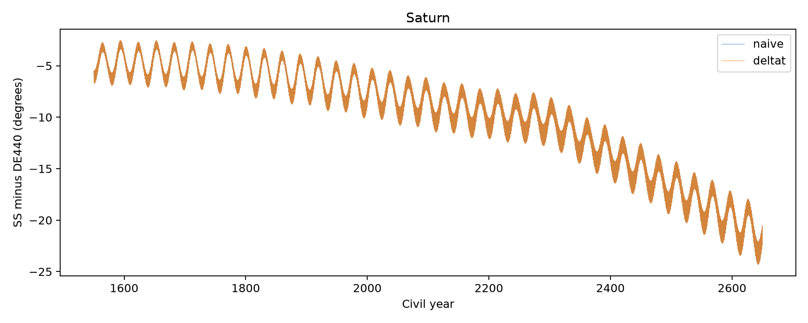
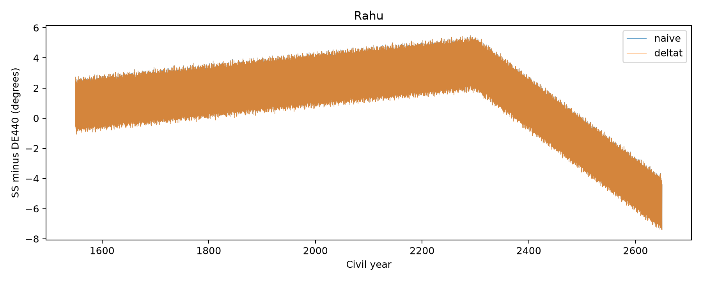
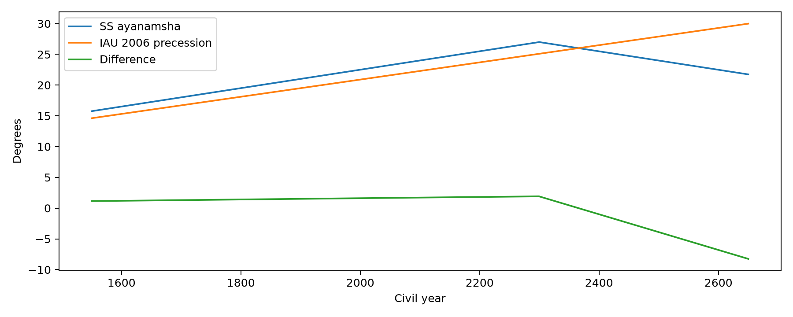

# Evaluating the Accuracy of Surya Siddhanta Planetary Algorithms against JPL DE440, 1550-2649 CE

**Author:** Ashutosh Nigam

---

## Abstract

The *Surya Siddhanta* is an influential astronomical text of classical India whose methods were used for panchang-making for many centuries. We implement its planetary theory in Python, using Ebenezer Burgess's English translation (1860) and Mahavir Prasad Srivastava's Hindi book, *Surya Siddhanta: Vigyan Bhashya*, as the two textual sources for the implementation. No modern ephemeris provides positions to the Surya Siddhanta calculation. We compare the resulting tropical longitudes of the Sun, Moon, Mercury, Venus, Mars, Jupiter, Saturn and the lunar node (Rahu) with JPL DE440 at 40,176 ten-day epochs from 1550 to 2649 CE. This window lies within DE440's coverage. Historical epochs evaluate the adopted uncorrected implementation; future epochs show its extrapolation.

We examine mean-motion drift, the residual structure after detrending, the trepidation model of precession (ayanamsha), and the conversion from Ujjain local mean time to Terrestrial Time with Delta-T. Through 2249 CE the per-century RMS longitude error is 1.14 to 1.93 degrees for the Sun, 1.69 to 2.29 for the Moon, and 1.88 to 9.45 for the five star-planets. Saturn has the largest fitted drift in the precession-corrected diagnostic (-29.5 arcseconds per Julian year), and Venus the largest detrended RMS. The trepidation contribution rises from +1.15 to +1.92 degrees before reversing in 2299 CE. By the final epoch it is -8.25 degrees, and the last-century RMS for each body from the Sun through Mars exceeds 11 degrees. These results quantify this implementation and comparison convention; they do not directly measure historical panchang practice or eclipse timing.

---

## 1. Introduction

The *Surya Siddhanta* is a Sanskrit astronomical treatise. Its received text dates to somewhere between the fifth and tenth centuries CE, and its parameters are set to an epoch near 499 CE, the year its precession model puts the vernal equinox at the start of sidereal Aries. Across fourteen chapters it gives complete procedures for mean and true planetary positions, eclipses, conjunctions, heliacal risings, the lunar crescent and the calendar. Ebenezer Burgess's English translation of 1860 opened the text to historians of science, and Burgess describes it as still the standard authority of Indian panchang-makers (*panchangkartas*) in his time. It has been studied widely as a document. It has much less often been *run* and measured.

Related computational work includes Santhoju et al. (2025), who implemented location-specific Surya Siddhanta nirayana planetary positions and compared them with Stellarium. Their model includes modifications such as fractional ahargana. Historical and mathematical studies also analyse Indian planetary algorithms and later parameter corrections (Pingree 1978; Duke 2005; Plofker 2009). The contribution here is a specified 1,100-year DE440 comparison of an uncorrected SS implementation, with explicit frame and time conventions and reproducible statistical diagnostics. We do not claim to be the first to evaluate the Surya Siddhanta computationally. [Santhoju et al. (2025)](https://link.springer.com/article/10.1007/s12036-024-10018-8)

The question here is a narrow one: at the sampled dates between 1550 and 2649 CE, how far do longitudes from this implementation depart from the DE440 reference, and which model choices possibly explain that departure? Historical interpretation requires additional evidence about the parameters and procedures actually used by particular panchang-makers. Future epochs expose the consequences of the chosen constants, including the reversal of the trepidation model in 2299 CE.

Section 3 describes the implementation and the numerical choices relevant to the evaluated Chapter 1/2 longitude path. Section 4 defines the DE440 comparison. Section 5 reports errors by body and century and fits secular and long-period components. Section 6 discusses model interpretation and limitations. Section 7 concludes, Section 8 states where the code and data are available, and Appendix A maps each evaluated quantity to its verses and code.

## 2. Background

### 2.1 The Surya Siddhanta planetary model

The Surya Siddhanta model is geocentric and eccentric-epicyclic.

Each body starts from a mean longitude (Ch. 1, v. 29-34, 53). This is its number of revolutions in a mahayuga of 4,320,000 years multiplied by the elapsed fraction of the yuga, where the elapsed time is counted in civil days (*ahargana*) from the Kali epoch: midnight of 17/18 February 3102 BCE on the Ujjain meridian. Table 1 lists the revolution counts. For Mercury and Venus the mean planet is the mean Sun, and the listed revolutions belong to the *sighrocca*, which corresponds to the planet's heliocentric mean longitude.

The manda correction (Ch. 2, v. 29-45) is the equation of centre. It comes from an epicycle whose circumference is given as a number of degrees of the deferent (the main orbit), and the epicycle itself shrinks or grows with the anomaly (v. 34-38). In place of trigonometric functions the text uses the sine table of Ch. 2 v. 15-27, 24 entries at radius 3438.

The five star-planets also get a sighra correction (Ch. 2, v. 39-45), from a second epicycle centred on the mean planet. Its high point, the *sighrocca*, is the mean Sun for Mars, Jupiter and Saturn, and has its own mean motion for Mercury and Venus. The text applies the two corrections in four steps: half sighra, half manda, full manda, full sighra.

Rahu, the ascending node, has only a mean retrograde motion (Ch. 1, v. 29-34). The text gives it no equation.

Precession (Ch. 3, v. 9-12) is a *trepidation*: an oscillation of amplitude 27 degrees and period 7,200 years, zero in 499 CE. The ayanamsha grows at 54 arcseconds per year until it reaches 27 degrees in 2299 CE, and then decreases. Every Surya Siddhanta longitude is sidereal, and adding the ayanamsha gives the text's tropical longitude.

The Surya Siddhanta has no lunar evection, variation or annual equation. Its Moon has a single manda epicycle.

**Table 1. Mean-motion parameters (Ch. 1) and their modern values.** The modern sidereal rate is the mean element of date (Meeus 1998, Table 31.A and eqs. 25.2, 47.1, 47.7) less IAU 2006 general precession (5028.796 arcseconds per century).

| Body | Revolutions per mahayuga | Surya Siddhanta mean motion (deg/day) | Modern sidereal (deg/day) | Surya Siddhanta minus modern (arcsec/year) |
|---|---|---|---|---|
| Sun | 4,320,000 | 0.9856027 | 0.9856091 | -8.5 |
| Moon | 57,753,336 | 13.1763521 | 13.1763582 | -8.0 |
| Mercury (sighrocca) | 17,937,060 | 4.0923180 | 4.0923388 | -27.3 |
| Venus (sighrocca) | 7,022,376 | 1.6021464 | 1.6021305 | +20.9 |
| Mars | 2,296,832 | 0.5240194 | 0.5240328 | -17.7 |
| Jupiter | 364,220 | 0.0830963 | 0.0830912 | +6.8 |
| Saturn | 146,568 | 0.0334393 | 0.0334597 | -26.8 |
| Moon's node | 232,238 (retrograde) | -0.0529848 | -0.0529920 | +9.5 |
| Moon's apogee | 488,203 | 0.1113829 | 0.1113653 | +23.2 |

The node's motion is retrograde, so its positive difference means the Surya Siddhanta node moves backward 9.5 arcseconds per year *more slowly* than the true one. The node is compared with its sidereal rate, as every other row is, not its tropical rate.

The Surya Siddhanta sidereal year is 365.258756 days, against the modern 365.256363, too long by 0.002393 days (3.4 minutes) each year. Every mean longitude tied to the Sun therefore falls behind by 8.5 arcseconds a year, which comes to 2.6 degrees across the 1,100-year window.

### 2.2 JPL DE440

DE440 (Park et al. 2021) is a numerically integrated ephemeris fitted to spacecraft ranging, lunar laser ranging and astrometry. The local kernel covers JD 2287184.5 to 2688976.5, corresponding to 1549-12-31 through 2650-01-25 in the proleptic Gregorian calendar. DE441 provides a longer integration for other windows. We use DE440 as a modern reference at the degree-scale resolution of this study. Its agreement with observations and other ephemerides does not establish a uniform subarcsecond absolute-error bound across all bodies and all 1,100 years; uncertainty grows beyond the observational interval. [Park et al. (2021)](https://ssd.jpl.nasa.gov/doc/Park.2021.AJ.DE440.pdf)

### 2.3 Why the frame and the clock matter

What counts as "error" here depends on two choices.

The first is the frame. Surya Siddhanta longitudes are sidereal, while DE440's ICRS vectors can be transformed to the mean ecliptic and equinox of date. Our primary comparison adds the Surya Siddhanta ayanamsha to its sidereal longitude, and so includes the effect of the trepidation model. This is an analytical choice; it does not imply that all traditional panchangs reported tropical longitudes. A second diagnostic subtracts the difference between the Surya Siddhanta ayanamsha and IAU 2006 general precession. We call this the *precession-corrected residual*. It is a scalar longitude correction, not a complete rotation into a fixed ecliptic plane; the ecliptic pole also changes with time.

The second is the clock. The Surya Siddhanta counts from midnight on the Ujjain meridian (75.79 degrees east) in local mean time. DE440 runs on Barycentric Dynamical Time, which for our purposes is Terrestrial Time (TT). Two things separate them. One is the fixed longitude offset of 5.05 hours. The other is Delta-T (TT minus Universal Time), which was about 152 s in 1550, fell to a minimum of about -6 s around 1893, stood at 64 s in 2000, and is extrapolated to 2,184 s by 2649 (Espenak and Meeus 2006). The Moon moves 0.55 degrees an hour, so the longitude offset alone amounts to 2.8 degrees of lunar longitude and Delta-T up to another 0.33. We run the comparison both ways, once without correction, taking the Surya Siddhanta Julian Day as TT, and once with the correction, and report both.

### 2.4 Key technical terms

The following technical terms are used throughout. They are standard in astronomy and statistics and are kept for precision; this list gives their meaning.

| Term | Meaning |
|---|---|
| Ephemeris (plural ephemerides) | A table of computed positions of the Sun, Moon and planets over time; DE440 is a modern one. |
| Epoch | One sampled date in the comparison; this study uses 40,176 epochs ten days apart. |
| Sidereal / tropical longitude | Longitude measured from a fixed point among the stars (*nirayana*) / from the moving vernal equinox (*sayana*). |
| Precession; ayanamsha | The slow westward shift of the equinox against the stars; the *nirayana–sayana* difference that results. |
| Trepidation | The Surya Siddhanta's model of precession as a back-and-forth swing of the equinox (27 degrees each way over 7,200 years), not a steady drift. |
| Deferent, epicycle, eccentric | The main circular orbit; a smaller circle carried on it that produces the correction; an orbit whose centre is offset from the Earth. |
| Anomaly (*kendra*) | The angle from the apogee (or *sighrocca*) that sets the size of a correction. |
| Residual | Surya Siddhanta longitude minus DE440 longitude at one epoch: the error being measured. |
| RMS | Root-mean-square: the typical size of the residuals in a group, whatever their sign. |
| Drift; secular | Steady growth of the error per year; long-term, as opposed to periodic. |
| Detrended | With the best-fitting straight line removed, so that only the periodic and irregular part remains. |
| Osculating node | The ascending node of the Moon's actual orbit at one instant, which swings around the mean node. |
| Kernel | The DE440 data file (`de440.bsp`) from which reference positions are read. |
| Provenance | The record of how a result was produced: input file checksums, software versions and code commit. |
| Aliasing | When ten-day sampling makes a faster cycle, such as the Moon's 14.8-day term, look like a slower one. |
| Proleptic Gregorian calendar | The Gregorian calendar extended backwards to dates before its adoption in 1582. |
| Scalar correction | A single number added to or subtracted from the longitude, not a full rotation of coordinates. |
| Barycentre; nutation; aberration | The centre of mass of a planet and its moons; a small nodding of the Earth's axis; the apparent shift of a body caused by the observer's motion. |

## 3. The implementation

### 3.1 Design

The library (`suryasiddhanta`, Python >=3.9 in package metadata, NumPy as its core dependency) has one module for each chapter of the text. Verse references occur in docstrings and comments, but the evaluated call path is specifically `ch01_mean_motions.mean_longitude`, `ch02_true_places.true_longitude_full`, and `ch02_true_places.ayanamsha`. Calendar conversion uses the Julian calendar before 1582-10-15 and the Gregorian calendar thereafter. Civil-year grouping is computed from those dates, separately from the uniform time coordinate used in regression.

The Surya Siddhanta longitude path does not use a modern ephemeris. It applies the adopted mean-motion constants and the four-step sighra/manda procedure without bija corrections. `jya()` interpolates the 24-entry sine table at radius 3438, while the correction routines use modern inverse sine and square-root arithmetic, including a derived cosine. The implementation therefore combines historical tabulated sines with modern numerical operations; it does not reproduce historical table arithmetic at every step. The true-longitude entry point rounds to 0.0001 degrees (0.36 arcsec). These choices must be distinguished from the simple assumption that every discrepancy is a property of the text alone.

### 3.2 Verification against worked examples

The repository includes worked-example tests based on Mahavir Prasad Srivastava's Hindi *Surya Siddhanta: Vigyan Bhashya* and chapter audits. The Hindi book was consulted through OCR transcripts that systematically misread the period typeface's nine (९) as six (६). All numerical constants on the evaluated path follow Burgess, and each worked-example value used in a test was checked arithmetically or against the scan. Corrections made during development included the manda-kendra sign convention, planetary latitude, lambana, and valana. For the revalidation of this paper, all 263 focused Chapter 1/2 tests passed, and all 642,816 original residual values were independently reconstructed against the local DE440 kernel within 0.00000055 degrees. These checks establish implementation consistency, not complete historical or astronomical correctness. The recent Chapter 3–14 corrections do not enter this longitude comparison.

### 3.3 Limitations of the implementation that bound this study

- The lunar apparent diameter is scaled by true/mean daily lunar motion, using centred one-day differences; the solar and shadow diameter helpers retain fixed mean values. Full asakrit eclipse iteration is not implemented, and eclipses are not evaluated here.
- Chapter 8 reads star coordinates as ecliptic, Chapter 13 as polar (neither is used here).
- The text gives the lunar node no equation, so the implementation returns its mean longitude.

## 4. Method

### 4.1 Choice of window

The window 1550-2649 CE comes from the reference ephemeris. We considered moving it and decided against it, for four reasons.

First, the chosen civil-year window lies within the local DE440 kernel. Julian 1550-01-01 is JD 2287195.5, eleven days after the kernel starts; Gregorian 2649-12-25 is JD 2688945.5, 31 days before it ends. These margins allow for the reference time shift, which moves an epoch approximately 0.21 days earlier at most. The selected window is slightly shorter than the kernel's complete coverage.

Second, a much earlier window would require a longer reference ephemeris such as DE441. DE441 omits the lunar core-mantle damping used in DE440 to permit a much longer backward integration. An extension would require checking the overlap and recomputing the results; we do not assume that every displayed digit would remain unchanged. The present study continues to use the available approximately 114 MiB DE440 kernel.

Third, the historical part of the window includes increasingly precise constraints on Delta-T from telescopic observations and, later, atomic time. Earlier values and future extrapolations are less reliably known. This point supports the historical interval but does not make the entire window equally well determined.

Fourth, the window includes historical epochs during which the text was in use and future epochs that expose the consequences of its parameters. These future epochs include the reversal of the implemented trepidation near 2299 CE. Both intervals evaluate the same uncorrected model; the historical interval alone is not evidence that these exact parameters were used in practice.

The choice has a cost. The Surya Siddhanta mean motions were set near 499 CE, and their errors grow with distance from that epoch. A window starting a thousand years later sees the text after its secular errors have already built up (Table 5, offset column), not where it was most accurate.

### 4.2 Grid

The grid runs from 1550-01-01 (Julian calendar) to 2649-12-25 (Gregorian calendar, the last ten-day step before 2649-12-31), giving 40,176 epochs. This sampling does not resolve the Moon's approximately 14.8-day variation: any harmonic analysis of aliased terms requires an explicit design matrix and conditioning checks. We make no claim here that every lunar term has been separated. Century groups are assigned from the civil year, in eleven groups from 1550–1649 through 2550–2649. The previous decimal-year labels misplaced twelve epochs; the revised tables use corrected groups. The regeneration driver hashes the little-endian float64 JD array for provenance.

### 4.3 Surya Siddhanta side

For each epoch and body we compute the sidereal true longitude and add the Ch. 3 ayanamsha to obtain the tropical longitude. Rahu uses the mean ascending-node longitude. The regeneration script (Section 8) recomputes these quantities directly from the chapter functions.

### 4.4 Reference side

For each epoch we take DE440's geocentric geometric vectors and rotate them from ICRS to the mean ecliptic and equinox of date using the IAU 2006 formulation, equivalent to `erfa.ecm06`. The regeneration implementation includes frame bias. Mercury, Venus, Mars, Jupiter and Saturn use planetary-system barycentre vectors; the Sun and Moon use their corresponding kernel vectors relative to Earth. Light-time, aberration and nutation are omitted because the target of comparison is geometric mean-frame longitude. For Rahu we rotate the Moon's geocentric position and velocity into that frame, form their cross product, and calculate the ascending node of the osculating plane. This reference contains a roughly 173-day oscillation about the mean node, which is absent from the Surya Siddhanta mean-node model.

There are two versions of the reference time scale:

- **Uncorrected time** (labelled `naive` in the data files and plots): TT = JD, the Surya Siddhanta Julian Day.
- **Delta-T corrected** (labelled `deltat`): TT = JD - 75.7873/360 + Delta-T(JD)/86400, with Delta-T from the piecewise polynomials of Espenak and Meeus (2006). Before 1600 these fit Morrison and Stephenson (2004); from 1600 to 2005 they follow the telescopic and modern record; after 2005 they are an extrapolation ending in the long-term parabola -20 + 32u^2 (u in centuries from 1820).

### 4.5 Metrics

The residual is the Surya Siddhanta tropical longitude minus DE440 longitude of date, wrapped to [-180, 180). For each civil century we calculate the sample count, mean, RMS and maximum absolute residual with its sign. The precession-corrected diagnostic subtracts the Surya Siddhanta ayanamsha minus IAU 2006 accumulated general precession. Its linear fit uses `x = (JD - julian_day(2100, 1, 1))/365.25`, so slopes are per Julian year and offsets refer to Gregorian 2100-01-01. The RMS after detrending includes periodic structure and any nonlinear secular remainder; it is not an isolated measurement of epicycle error. The tropical residual is not fitted with a single trend because its frame contribution changes slope by about 108 arcseconds/year at the trepidation reversal: from approximately +3.7 to -104.4 arcseconds/year.

### 4.6 Reproducibility

All results were computed from the local DE440 kernel (SHA-256 `a4ce9bf9b3282becc9f4b2ac3cebe03a2ae7599981aabd7265fd8482fff7c4b5`) on the ten-day grid of §4.2, whose JD array has SHA-256 `8d2d5d7cbda66baf8b966aa38f0fb226381306cf842efc382953a973315d235b`. The environment was Python 3.14.6, NumPy 2.5.4 and jplephem 2.24 on Linux. A rerun on 2026-10-13 reproduced every cell of Tables 2–6 and every diagnostic quoted in Sections 5–7; Figures 1–4 and the CSV files are the outputs of that run. The regeneration script records package versions, source hashes and output hashes with each saved run (Section 8).

## 5. Results

### 5.1 Error versus time

**Figure 1.** Sun and Moon residuals, 1550-2649 CE, uncorrected-time (`naive`) and Delta-T-corrected (`deltat`) variants overlaid. (Data: `residuals_naive.csv`, `residuals_deltat.csv`, `residual_deg`.)

**Figure 2.** The five star-planets, same layout.

**Figure 3.** Rahu, showing the 173-day osculating oscillation on top of the secular drift.

Every body's tropical residual changes direction at 2299 CE, where the Surya Siddhanta ayanamsha reaches its peak and starts falling (Figure 4).

### 5.2 Per-century statistics

**Table 2. RMS residual (degrees), Delta-T-corrected variant, corrected civil-century grouping.** Data: `century_deltat.csv`.

| Century | Sun | Moon | Mercury | Venus | Mars | Jupiter | Saturn | Rahu |
| --- | --- | --- | --- | --- | --- | --- | --- | --- |
| 1550-1649 | 1.14 | 1.69 | 3.31 | 4.16 | 1.88 | 2.09 | 4.88 | 1.50 |
| 1650-1749 | 1.27 | 1.76 | 3.25 | 4.74 | 2.21 | 2.24 | 4.90 | 1.79 |
| 1750-1849 | 1.39 | 1.85 | 3.20 | 5.38 | 2.67 | 2.45 | 5.70 | 2.10 |
| 1850-1949 | 1.53 | 1.95 | 3.16 | 5.96 | 2.96 | 2.87 | 6.35 | 2.42 |
| 1950-2049 | 1.66 | 2.05 | 3.14 | 6.61 | 3.36 | 3.33 | 7.44 | 2.76 |
| 2050-2149 | 1.79 | 2.16 | 3.13 | 7.23 | 3.85 | 3.84 | 8.77 | 3.10 |
| 2150-2249 | 1.93 | 2.29 | 3.14 | 7.77 | 4.16 | 4.29 | 9.45 | 3.43 |
| 2250-2349 | 2.51 | 2.79 | 3.45 | 8.55 | 4.95 | 4.19 | 10.67 | 3.43 |
| 2350-2449 | 5.30 | 5.39 | 5.78 | 10.17 | 7.98 | 2.12 | 13.56 | 1.63 |
| 2450-2549 | 8.41 | 8.46 | 8.71 | 12.58 | 11.20 | 1.94 | 16.65 | 2.16 |
| 2550-2649 | 11.54 | 11.58 | 11.75 | 15.14 | 14.56 | 4.45 | 20.04 | 4.56 |

**Table 3. Largest absolute residual (degrees), Delta-T-corrected variant, corrected civil-century grouping.** Computed from sampled epochs; these are not guaranteed continuous-time maxima.

| Century | Sun | Moon | Mercury | Venus | Mars | Jupiter | Saturn | Rahu |
| --- | --- | --- | --- | --- | --- | --- | --- | --- |
| 1550-1649 | 1.45 | 4.43 | 10.65 | 18.56 | 8.61 | 3.54 | 7.11 | 3.05 |
| 1650-1749 | 1.58 | 4.59 | 10.34 | 20.00 | 9.92 | 3.83 | 7.38 | 3.49 |
| 1750-1849 | 1.72 | 4.75 | 10.32 | 22.80 | 10.52 | 4.10 | 8.24 | 3.88 |
| 1850-1949 | 1.85 | 4.93 | 10.01 | 24.88 | 12.18 | 4.80 | 9.39 | 4.18 |
| 1950-2049 | 2.00 | 5.21 | 10.01 | 27.01 | 12.97 | 5.38 | 10.25 | 4.54 |
| 2050-2149 | 2.14 | 5.31 | 9.68 | 29.23 | 14.23 | 6.03 | 11.58 | 5.01 |
| 2150-2249 | 2.28 | 5.52 | 9.70 | 31.73 | 15.12 | 6.67 | 12.44 | 5.29 |
| 2250-2349 | 3.94 | 7.03 | 10.72 | 34.53 | 16.77 | 6.74 | 14.50 | 5.49 |
| 2350-2449 | 7.08 | 10.42 | 13.45 | 39.81 | 21.01 | 5.22 | 17.46 | 4.03 |
| 2450-2549 | 10.23 | 13.48 | 16.48 | 45.55 | 25.29 | 4.52 | 20.49 | 4.83 |
| 2550-2649 | 13.37 | 16.79 | 19.25 | 48.94 | 28.92 | 7.23 | 24.31 | 7.43 |

Only Jupiter and Rahu have a per-century RMS that falls after 2299. Both carry a positive mean-motion error (Table 1), which the falling frame error first cancels and then exceeds, so their century means (`mean_deg`) pass through zero: Jupiter's goes from +1.61 in 2350-2449 to -1.35 in 2450-2549, and Rahu's from +0.95 to -1.70 over the same two centuries.

**Table 4. Effect of the time scale: whole-window RMS (degrees).** All 40,176 epochs are taken together. The last column subtracts the scalar frame difference defined in §4.5.

| Body | Uncorrected-time RMS | Delta-T-corrected RMS | Uncorrected minus corrected | Delta-T-corrected, precession-corrected RMS |
| --- | --- | --- | --- | --- |
| Sun | 4.96 | 4.81 | +0.14 | 3.59 |
| Moon | 7.02 | 4.95 | +2.06 | 3.75 |
| Mercury | 5.55 | 5.48 | +0.07 | 4.45 |
| Venus | 8.67 | 8.66 | +0.01 | 8.05 |
| Mars | 6.77 | 6.70 | +0.07 | 5.62 |
| Jupiter | 3.21 | 3.21 | -0.00 | 2.16 |
| Saturn | 10.95 | 10.95 | +0.01 | 10.21 |
| Rahu | 2.78 | 2.77 | +0.00 | 1.79 |

The largest time-scale effect is on the Moon. Its uncorrected-time century means are 2.48 to 2.77 degrees below the Delta-T-corrected means. This is consistent with its approximately 2.77-degree motion over the Ujjain offset, modified by Delta-T. The whole-window lunar RMS falls by 2.06 degrees. The Sun's RMS changes by 0.14 degrees, and each other body's RMS changes by less than 0.08 degrees. These are differences in RMS, not maximum instantaneous longitude shifts.

### 5.3 Linear drift and remaining structure

**Table 5. Linear fit of the precession-corrected residual, Delta-T-corrected variant.** Slopes use Julian years and offsets refer to Gregorian 2100-01-01. The predicted column uses the rounded rates in Table 1; differences are calculated before rounding the measured slope.

| Body | Drift (arcsec/Julian year) | Offset at 2100-01-01 (deg) | Detrended RMS (deg) | Predicted drift, Table 1 | Measured minus predicted |
| --- | --- | --- | --- | --- | --- |
| Sun | -8.57 | -3.504 | 0.198 | -8.5 | -0.1 |
| Moon | -8.85 | -3.363 | 1.456 | -8.0 | -0.9 |
| Mercury | -8.58 | -3.529 | 2.597 | -27.3 | +18.7 |
| Venus | -8.51 | -3.500 | 7.205 | +20.9 | -29.4 |
| Mars | -17.70 | -5.128 | 1.688 | -17.7 | -0.0 |
| Jupiter | 7.84 | 1.823 | 0.933 | +6.8 | +1.0 |
| Saturn | -29.52 | -9.776 | 1.401 | -26.8 | -2.7 |
| Rahu | 9.34 | 1.165 | 1.076 | +9.5 | -0.2 |

For five of the eight bodies (Sun, Moon, Mars, Jupiter and Rahu), the measured drift differs from the Table 1 prediction by less than 2 arcseconds per Julian year. This agreement is consistent with an important contribution from the Chapter 1 mean motions. It does not uniquely divide the fitted slope among mean motion, reference-frame convention, time conversion, and unresolved long-period terms.

Mercury and Venus do not show the drift of their sighrocca in this geocentric diagnostic. Their fitted drifts (-8.58 and -8.51) match the Sun's (-8.57) to within 0.1 arcseconds per Julian year. This is consistent with the Surya Siddhanta mean planet being the mean Sun, with the sighrocca causing a bounded geocentric swing. Its influence can therefore remain in the detrended structure rather than appearing as the same secular slope as the heliocentric mean element.

To test sensitivity to a long-period component, we jointly fit an intercept, a linear trend and sine/cosine terms with a fixed period of 883 Julian years: `r = a + b*x + A*sin(2*pi*x/883) + B*cos(2*pi*x/883)`, where `x` is defined in §4.5. Jupiter's fitted drift becomes +7.144 arcseconds/year with amplitude 18.463 arcminutes; Saturn's becomes -27.861 arcseconds/year with amplitude 44.208 arcminutes. Saturn's drift changes by 1.659 arcseconds/year relative to the linear-only fit, leaving a difference of approximately -1.06 from the rounded Table 1 prediction. This is a sensitivity calculation motivated by the Jupiter–Saturn great inequality. Over only about 1.25 cycles, the harmonic and trend are correlated, so the fit does not uniquely identify that physical perturbation or explain the remaining difference. Earlier coefficients and the additional anomaly/synodic fit are omitted because their generating method was not reproducible.

### 5.4 The trepidation ayanamsha

**Figure 4.** Surya Siddhanta ayanamsha, IAU 2006 accumulated precession since 499 CE, and their difference.

**Table 6. Surya Siddhanta ayanamsha and IAU 2006 accumulated general precession (degrees).** Rows are the first epoch, the epochs nearest 2100-01-01 and 2400-01-01, the sampled maximum ayanamsha, and the final epoch. Dates are Gregorian unless marked Julian. The precession zero is `KALI_EPOCH_JD + 3600*SIDEREAL_YEAR_DAYS`.

| Civil date | Surya Siddhanta ayanamsha | IAU 2006 precession | Surya Siddhanta minus reference |
| --- | --- | --- | --- |
| 1550-01-01 (Julian) | 15.761 | 14.616 | +1.146 |
| 2099-12-28 | 24.010 | 22.292 | +1.718 |
| 2299-04-24 | 27.000 | 25.079 | +1.921 |
| 2400-01-05 | 25.489 | 26.487 | -0.998 |
| 2649-12-25 | 21.740 | 29.987 | -8.247 |

The implemented triangular ayanamsha reaches its exact maximum at JD 2560862.785, corresponding to Gregorian 2299-04-21 with fractional local day 0.285. The nearest sampled maximum is on 2299-04-24. The Surya Siddhanta rate is 54 arcseconds per Surya Siddhanta sidereal year, approximately 54 per Julian year; before reversal it exceeds the reference precession rate, producing a frame difference that grows from +1.15 to +1.92 degrees. After reversal the difference decreases at approximately 104.4 arcseconds per Julian year and is -8.247 degrees at the last epoch. Subtracting this difference gives the precession-corrected diagnostic. This scalar correction keeps the ecliptic-of-date convention; it is not a full fixed-plane transformation.

## 6. Discussion

### 6.1 Where the error comes from, body by body

The drift, offset and detrended RMS below come from Table 5; century statistics are computed by the regeneration script (Section 8). Model interpretations are distinguished from measured diagnostics. Detailed lunar harmonic amplitudes and anomaly/elongation-bin estimates from the earlier draft are omitted because their generating scripts, arguments and bin definitions were unavailable.

**Sun.** The measured precession-corrected drift is -8.57 arcseconds/year, close to the mean-motion prediction of -8.5. Before the trepidation reversal, the frame contribution partially cancels this lag: the tropical century means change from -1.12 degrees in 1550–1649 to -1.92 in 2150–2249. The final-century mean is -11.50 degrees. The residual after removing the linear trend is 0.198 degrees RMS. A mismatch in the manda equation is a likely contributor; quantifying individual annual harmonics requires a separately specified fit.

**Moon.** The fitted drift is -8.85 arcseconds/year, compared with the approximate mean-motion prediction of -8.0. Delta-T and long-period structure can contribute to this difference, but this regression does not establish an exact division of causes. The detrended RMS is 1.456 degrees. The single Surya Siddhanta manda epicycle omits the separate evection, variation and annual-equation terms of modern lunar theory. This provides a physical reason to expect periodic differences, without establishing their individual fitted amplitudes. The time-scale conversion reduces the whole-window lunar RMS by 2.06 degrees.

**Mercury.** The fitted drift (-8.58 arcseconds/year) closely follows the mean Sun. The Surya Siddhanta mean Mercury is the mean Sun, while its sighrocca causes the bounded geocentric swing. The detrended RMS is 2.597 degrees, decreasing from 3.10 in the first civil century to 2.13 in the last. Sighrocca phase and epicycle geometry can contribute to that structure; linking it precisely to perihelion or to an individual harmonic requires additional diagnostics.

**Venus.** The fitted drift (-8.51 arcseconds/year) also follows the mean Sun. Venus has the largest detrended RMS, 7.205 degrees, increasing from 4.00 in the first civil century to 9.87 in the last. About 10.04% of sampled epochs have absolute detrended errors above ten degrees, and the largest sampled tropical error is 48.94 degrees. Near inferior conjunction, small geocentric distance can amplify a heliocentric position error. However, small elongation also occurs near superior conjunction; an elongation-only bin cannot establish this mechanism. A distance- or conjunction-branch-resolved analysis is required.

**Mars.** The fitted drift is -17.70 arcseconds/year, close to the mean-motion prediction, corresponding to about 5.4 degrees over the window. Its detrended RMS is 1.688 degrees and increases from 1.19 to 2.22 by civil century. Geocentric longitude can be particularly sensitive to model errors near opposition. The sighra angular correction itself is zero at exact opposition, so enhanced sensitivity must not be described as a maximum of that correction. Quantitative opposition/conjunction-bin comparisons require a specified additional analysis.

**Jupiter and Saturn.** Jupiter's linear-only drift is +7.84 arcseconds/year; including the specified 883-year harmonic changes it to +7.144. Saturn's linear-only drift is -29.52 arcseconds/year, with a precession-corrected offset of -9.78 degrees at 2100-01-01 and detrended RMS of 1.401 degrees. Its drift becomes -27.861 in the joint fit. The change shows sensitivity to long-period structure; it does not uniquely identify the source of every difference from the approximate mean-motion prediction (§5.3).

**Rahu.** The node's fitted drift is +9.34 arcseconds/year, close to the predicted +9.5, giving about 2.8 degrees across the window. The detrended RMS is 1.076 degrees, consistent with the scale of the osculating reference's roughly 1.5-degree oscillation. Thus this statistic compares a mean-node model with an instantaneous osculating node and should not be interpreted solely as a Surya Siddhanta periodic error. A 17-sample moving average lowers the whole-window RMS from 2.772 to 2.556 degrees. At a ten-day interval its endpoints are 160 days apart (170 days if counted as sample count times interval); it is not an exact 173-day average. The calculation uses valid convolution, excluding incomplete edge windows.

### 6.2 What this means for the text's users

A tithi spans 12 degrees of Sun–Moon elongation. The common ayanamsha cancels in the elongation, and the similar solar and lunar drifts largely cancel. Across the sampled epochs, the mean absolute elongation error is 1.178 degrees and its maximum is 3.938 degrees. Dividing the mean error by the mean elongation rate of 12.19 degrees/day gives a characteristic timing scale of 2.32 hours. This is not a measurement of tithi-boundary or eclipse-timing error: those require event searches, variable relative angular speed, and, for eclipses, geometric and observer-specific validation.

Using `floor(elongation/12)` to compare tithi indices, 3,966 of the 40,176 sampled epochs differ by one tithi between the Surya Siddhanta and the Delta-T-corrected reference. None differs by more than one on this grid. An angular error below 12 degrees does not ensure identical tithi indices near a boundary, and ten-day sampling does not establish a continuous-time bound.

### 6.3 Frame choice

Subtracting the scalar frame difference reduces the Sun's whole-window RMS from 4.81 to 3.59 degrees. Reductions are 1.20 for the Moon, 1.08 for Mars, 1.05 for Jupiter, 1.03 for Mercury, 0.98 for Rahu, 0.74 for Saturn and 0.61 for Venus. These results describe the precession-corrected convention defined in §2.3. Comparison in a fixed ecliptic plane would require transforming the full vectors and specifying that plane and its zero direction.

### 6.4 Threats to validity

- **Reading of the text.** Interpreting a verse differently can change a result. We reduce this risk through verse references for relevant calculations and tests based on Mahavir Prasad Srivastava's worked examples, but the implementation remains one reading among several possible ones.
- **No bija corrections.** These results describe an uncorrected parameter set. They are not an upper bound on historical practice: a correction can improve some epochs or metrics and make others worse.
- **Delta-T model.** The historical polynomials have epoch-dependent uncertainty, and their future continuation is an extrapolation. For scale, a 1,000-second timing change corresponds to about 0.15 degrees of mean lunar motion. This is a sensitivity estimate, not a bound on future uncertainty. We have not assigned a uniform confidence interval to the entire 1,100-year window. [NASA Delta-T polynomial specification](https://eclipse.gsfc.nasa.gov/LEcat5/deltatpoly.html)
- **Future epochs.** Epochs after the period of observations compare two model extrapolations, not recorded historical experience.
- **Osculating node.** Rahu's comparison includes physical oscillations absent from a mean-node model.
- **Sampling and attribution.** The largest and smallest sampled values do not guarantee continuous-time bounds. A detrended residual can contain nonlinear secular structure as well as periodic terms.
- **Numerical implementation.** Historical sine-table interpolation, modern inverse functions and 0.0001-degree output rounding are part of the evaluated implementation.

## 7. Conclusion

Evaluating this Surya Siddhanta implementation against DE440 from 1550 to 2649 CE gives reproducible longitude residuals for the selected frame and clock conventions. Through 2249, the Sun has the smallest per-century RMS among the evaluated bodies: 1.14 degrees initially and 1.93 by 2150–2249; its detrended RMS is 0.198 degrees. Saturn's per-century RMS ranges from 4.88 to 20.04 degrees and it has the largest linear-only drift (-29.5 arcseconds/year). Venus has the largest detrended RMS (7.2 degrees). The precession-corrected offsets at 2100-01-01 exceed the detrended RMS for every body except Venus. This comparison summarizes the relative scales of fitted offsets and remaining structure; it is not a unique physical decomposition.

The results are consistent with contributions from mean-motion errors, limitations of the epicyclic equations, missing lunar perturbations, and the trepidation model. The trepidation contribution changes from about +1.9 degrees near its 2299 reversal to -8.2 degrees at the final epoch. The 883-year joint fit shows that the estimated giant-planet drifts depend on treatment of long-period structure. The available calculations support the longitude comparison, while claims about individual harmonic amplitudes, historical practice, and event timing require further work. The script and data described in Section 8 allow the tables and figures to be regenerated from the DE440 kernel.

## 8. Code and data availability

The Python implementation of the Surya Siddhanta (`suryasiddhanta`), the regeneration script (`docs/evaluation/regenerate_paper.py`), step-by-step reproduction instructions (`docs/evaluation/REPRODUCE.md`) and the residual data behind every table and figure are available at https://github.com/mrashutoshnigam/surya-siddhanta. The script recomputes Tables 2–6, the diagnostics quoted in the text and Figures 1–4, and refuses to run unless the DE440 kernel matches the checksum given in §4.6. The kernel itself is distributed by JPL (https://naif.jpl.nasa.gov/pub/naif/generic_kernels/spk/planets/de440.bsp) and is not redistributed with the code.

## References

### Books used for the Surya Siddhanta implementation

- Burgess, Ebenezer (translator). (1860). *Translation of the Surya Siddhanta*. *Journal of the American Oriental Society*, 6.
- Srivastava, Mahavir Prasad (महावीर प्रसाद श्रीवास्तव). *Surya Siddhanta: Vigyan Bhashya* (सूर्य-सिद्धान्त: विज्ञान-भाष्य). Hindi commentary with worked examples.

### References for the comparison methods and related research
- Pingree, D. (1978). History of mathematical astronomy in India. *Dictionary of Scientific Biography* 15.
- Plofker, K. (2009). *Mathematics in India*. Princeton.
- Duke, D. (2005). The equant in India: the mathematical basis of ancient Indian planetary models. *Archive for History of Exact Sciences* 59.
- Park, R. S., Folkner, W. M., Williams, J. G., Boggs, D. H. (2021). The JPL planetary and lunar ephemerides DE440 and DE441. *AJ* 161:105.
- Morrison, L. V., Stephenson, F. R. (2004). Historical values of the Earth's clock error Delta-T and the calculation of eclipses. *JHA* 35:327.
- Stephenson, F. R., Morrison, L. V., Hohenkerk, C. Y. (2016). Measurement of the Earth's rotation: 720 BC to AD 2015. *Proc. R. Soc. A* 472.
- Espenak, F., Meeus, J. (2006). *Five Millennium Canon of Solar Eclipses*. NASA TP-2006-214141.
- Meeus, J. (1998). *Astronomical Algorithms*, 2nd ed. Willmann-Bell.
- Capitaine, N., Wallace, P. T., Chapront, J. (2003). Expressions for IAU 2000 precession quantities. *A&A* 412:567.
- Hilton, J. L., et al. (2006). Report of the International Astronomical Union Division I Working Group on Precession and the Ecliptic. *Celestial Mechanics and Dynamical Astronomy* 94:351–367.
- Santhoju, P., Bhalla, P., Behera, L., Pai, R. V. (2025). Mathematical model as per the algorithm of Suryasiddhanta for computation of location specific true position of the planets. *Journal of Astrophysics and Astronomy* 46, article 9. https://doi.org/10.1007/s12036-024-10018-8

## Appendix A. Verse map for the quantities evaluated

| Quantity | Surya Siddhanta verses | Module and function |
|---|---|---|
| Ahargana (civil days since epoch) | i.48-51 | `ch01_mean_motions.ahargana` |
| Mean longitudes | i.29-34, 53 | `ch01_mean_motions.mean_longitude` |
| Sine table | ii.15-27 | `ch02_true_places.jya` |
| Manda epicycle and correction | ii.29-38 | `ch02_true_places.manda_correction` |
| Sighra epicycle and correction | ii.39-42 | `ch02_true_places.sighra_correction` |
| Four-step true longitude | ii.43-45 | `ch02_true_places.true_longitude_full` |
| Ayanamsha (trepidation) | iii.9-12 | `ch02_true_places.ayanamsha` |
| Node mean motion | i.29-34, 43-44 | `ch01_mean_motions.mean_longitude("Moon_node")` |
